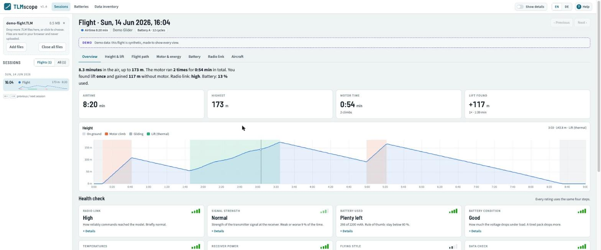
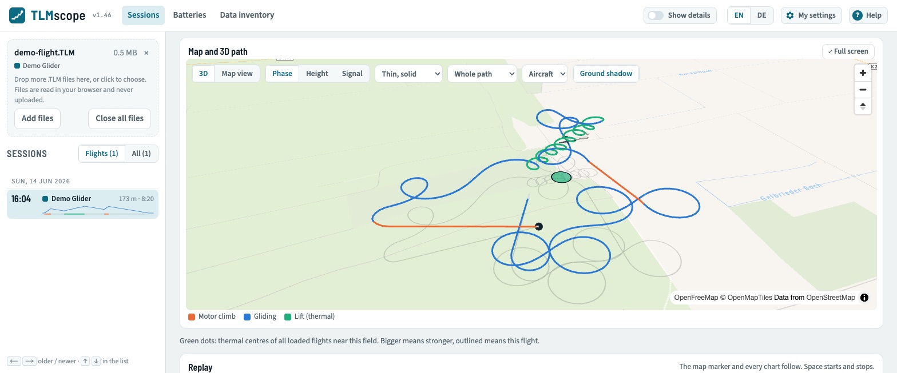

<p></p>

# TLMscope

TLMscope shows what happened during your RC flights. It reads the telemetry logs your transmitter saves and turns them into flight summaries, charts and simple ratings, with the exact values one click away.

Files are read in your browser. Nothing is uploaded.

**Open the app: [tlmscope.andreasknoor.com](https://tlmscope.andreasknoor.com)**, or try it with the built-in demo flight.



> **Status:** working app, published on Vercel; every push to `main` goes live (see [the plan](docs/implementation-plan.md)). More screenshots are at the end of this page.

## Using the app

1. Drop one or more `.TLM` files onto the page, or click **Load demo flight** to try a synthetic flight with GPS and a thermal.
2. Pick a session on the left (or with ← →). Each session has tabs: overview, height & lift, flight path, motor & energy, battery, radio link, aircraft.
3. **Show details** (top right) switches between the plain view (default: summaries, ratings and the main charts) and the full view: more charts and table columns, the exact values and thresholds behind every rating, and the raw data tab.
4. **Flight path** has a replay: play the flight back at up to 60× speed; the map marker and every chart follow, with an optional vario tone.
5. The interface is available in English and German (EN / DE, top right). **Help** explains which transmitters and sensors are supported.


## Who can use it

You can use TLMscope if you fly a model with a **Spektrum telemetry receiver** and your **Spektrum transmitter saves telemetry logs** (`.TLM` files).

### Transmitters

| Transmitter | Where the logs are | Status |
|---|---|---|
| Spektrum NX6, NX8, NX10 (incl. “+” versions) | Internal storage: `<Model>.TLM` and the `AutoLog` folder. Copy via USB. | Tested (NX8+) |
| Spektrum iX12, iX14, iX20 | Internal storage, copy via USB. | Expected to work, not tested yet |
| Spektrum DX6 G2/G3, DX7 G2, DX8 G2, DX9, DX10t, DX18 (G2 and later), DX18t, DX20 | SD card, once telemetry logging is on. | Expected to work, not tested yet |

### What you can see, and what it needs

A log only contains what the sensors in your model sent. Missing hardware means missing data, not an error.

| Data | Needs | Status |
|---|---|---|
| Radio link: frame losses, holds, fades, receiver voltage, signal strength | Any Spektrum telemetry receiver (model names ending in “T”) | Tested |
| Motor, controller and BEC: rpm, current, voltage, throttle, temperatures | Spektrum Smart ESC (e.g. Avian) | Tested |
| Battery: cell voltages, temperature, ID, charge cycles, capacity | Spektrum Smart battery, connected through a Smart ESC | Tested |
| Height and climb rate | Vario / altimeter sensor, or a receiver that reports it | Tested |
| Loads (g) and rotation rates | Receiver with AS3X / SAFE | Tested |
| Throttle stick position | Recent NX firmware (AutoLog files) | Tested |
| Stabilization mode | Receiver with AS3X / SAFE | Partly understood |
| Map, distance, speed over ground | Spektrum GPS telemetry sensor | Built from the specification, not tested yet |
| Other sensors (airspeed, extra current or temperature sensors, …) | X-Bus / SRXL2 sensors | Shown as raw data for now |

### Not supported

- EdgeTX / OpenTX logs (CSV, e.g. RadioMaster, FrSky, ExpressLRS, Crossfire): **planned**, not available yet.
- Other radio systems with their own log formats (Jeti, Graupner HoTT, Futaba, Multiplex …).
- Flight controller logs (ArduPilot, Betaflight blackbox, iNav).
- Spektrum transmitters that cannot save telemetry logs (e.g. DX6i).
- Live telemetry during the flight. TLMscope works with the saved files afterwards.
- Changing settings on the transmitter or receiver. TLMscope only reads.
- Cars and boats (Spektrum surface radios) are not a focus. Their logs may partly work.

### Getting your log files

- **NX and iX:** connect the transmitter by USB, choose the option to access internal storage in the USB settings, copy the `.TLM` files.
- **DX with SD card:** take the SD card out and copy the `.TLM` files.

TLMscope is an independent project, not made or endorsed by Spektrum or Horizon Hobby.

## Development

Requires Node.js 24 or later.

```sh
npm install
npm test                                   # unit tests; tests that need the private sample logs are skipped without them
npm run inspect -- samples/Easy_Glider_4.TLM          # sessions and sensor inventory
npm run inspect -- samples/*.TLM --fields --samples   # with decoded fields and raw packets
npm run docs                               # regenerate the channel table below
npm run dev                                # app on http://localhost:3000
npm run build                              # static export to out/
npm run demo                               # regenerate public/demo/demo-flight.TLM
```

**Versions.** The app version is `major.minor` from `package.json` and shows next to the name in the header. Every published update raises the minor version (1.1 → 1.2); the major version only changes on a deliberate decision. Pushes to `main` are published on Vercel automatically.

The code in `src/core/` is framework-free TypeScript. It runs in the browser, in Node.js (`node file.ts` runs it directly) and in tests.

```
src/core/
  model/        types, channel catalogue, normalisation (counters, derived mAh, frozen data)
  adapters/     one folder per input format, plus registry.ts
  analysis/     flight analyses on canonical channels, thresholds.ts holds every rating limit
  demo/         synthetic demo flight (also used by the end-to-end tests)
src/ui/         React views, charts (uPlot), map (MapLibre + deck.gl)
src/worker/     Web Worker that parses files off the main thread
src/i18n/       English and German texts
cli/            inspect, docs and demo scripts
samples/        real logs used by the tests (private, not in the repository, see samples/README.md)
prototype/      HTML prototype and brand sheet
brand/          logo files
```

## Data model

Every input format is read by an **adapter** that turns a file into the same model. Views, analyses and exports only use this model, never format-specific structures. To support a new format, write an adapter and add it to `src/core/adapters/registry.ts`.

```ts
interface LogAdapter {
  id: string;
  label: string;
  canRead(head: Uint8Array, fileName: string): boolean;   // cheap check on the first bytes
  parse(data: Uint8Array, fileName: string): LogFile;
}
```

- **`LogFile`** → **`Session[]`**: one session per power-up, or per logging run for formats without power-up markers. A session has a start time (`utc` or `local-unknown`), a duration, the model name, the source format, an optional **battery identity**, its **channels** and its **raw streams**.
- **`Channel`**: one time series with a canonical id from the catalogue below, a unit, a kind (`numeric`, `categorical`, `counter`), time in seconds since the session start, values, and a **quality flag per sample**:
  - `NO_DATA`: the sensor reported “no data”; the value is NaN.
  - `INTERPOLATED`: filled in between real samples.
  - `FROZEN`: stuck value (see below).
  - `DERIVED`: calculated, not measured (e.g. mAh from current).
  - `SUSPECT`: measured, but known to be unreliable.
- **Counters** (frame losses, holds, fades) are counts since the session start. The device's raw cumulative values stay available in `rawCounter`.
- **Absent is absent:** a channel a format or model does not have is simply missing. Analyses declare which channels they need, and the UI says what is missing.
- **Nothing is dropped:** every record type ends up in a **raw stream** with counts, decoded field statistics and the most common raw records. Values that are decoded but not mapped to the catalogue use ids starting with `raw:`.
- **Normalisation** runs after every adapter:
  - `consumed_mah` is derived from `motor_current` unless a sensor measures it;
  - channels with a `frozenCheck` are flagged `FROZEN` when they stay bit-for-bit identical for at least 80 % of the session (and 60 s) while the motor current changes by 5 A or more.

### Writing an adapter

1. Map each field to a catalogue id with SI units. Convert units in the adapter (km/h → m/s, °F → °C, ft → m).
2. Use `categorical` channels for text values (flight modes), with the labels in `categories`.
3. Split the file into sessions. If the format has no power-up markers, split at time gaps.
4. Leave session classification (flight, ground test, …) to the analysis layer.
5. Put everything you cannot map into raw streams or `raw:` channels.
6. Add real sample files and tests.

### Analyses

Analyses work only on canonical channels, resampled to a 1-second grid, so they work for every format that delivers the channels they need. Each returns either a result or the list of missing channels.

| Analysis | Needs | Result |
|---|---|---|
| Session kind | any channel; `altitude` or `ground_speed` for flights | flight, ground test, powered on, transmitter only |
| Flight profile | `altitude` and one of `throttle_output`, `motor_current`, `throttle_command` | phases (ground, motor climb, glide, lift), climbs with height gained and charge used, lift, glide sink rate, airtime |
| Circling | `rotation_rate.pitch`, `rotation_rate.yaw` | full circles, direction, time turning |
| Thermals | flight profile; circles with `rotation_rate.pitch/yaw`; centre and drift with GPS | per lift phase: gain, average and best 10 s climb, circles and height per circle, drift, motor time and mAh saved |
| Radio link | `frame_losses` or `link_quality` | level per second, overall level, frame losses per minute, holds in the air, fades |
| Signal strength | `signal_dbm` | level per second, overall level, weakest moment |
| Battery used | `consumed_mah` | mAh and percent of capacity (reported or assumed) |
| Battery condition | `pack_voltage`, `motor_current` | internal resistance per cell from voltage sag |
| Battery ageing | battery condition of several flights of one smart battery; `temperature.battery` if present | resistance trend per pack and charge cycles until 15 mΩ per cell (needs 5 flights over 2 weeks; cold flights below 15 °C and flights with stuck data are left out) |
| Charge estimate | `pack_voltage` | state of charge at start and end, from resting voltage |
| Cell balance | `cell_voltage.1`, `cell_voltage.2` (…) | largest spread between cells |
| Temperatures | any of `temperature.esc`, `.battery`, `.bec` | maxima and levels |
| Receiver power | `rx_voltage` | lowest voltage, level |
| Loads | `accel.x/y/z` | highest total g, flying style |
| Data check | – | frozen channels, battery not reporting, no cell voltages |

Every rating uses four levels. The overall level of a flight is the level held for at least 75 % of the airtime. All limits and their sources are in [`src/core/analysis/thresholds.ts`](src/core/analysis/thresholds.ts).

### Channel catalogue

Ids may also be `stick.*`, `switch.*` (control inputs) or `raw:*` (decoded but unmapped values).

<!-- catalogue:start (generated by `npm run docs`, do not edit) -->
| Id | Unit | Kind | Group | Meaning |
|---|---|---|---|---|
| `altitude` | m | numeric | flight | Height above the power-on point (barometric). |
| `climb_rate` | m/s | numeric | flight | Vertical speed, about 1 s average. Positive = climbing. |
| `climb_rate.0_25s` | m/s | numeric | flight | Vertical speed over 0.25 s. |
| `climb_rate.0_5s` | m/s | numeric | flight | Vertical speed over 0.5 s. |
| `climb_rate.1_5s` | m/s | numeric | flight | Vertical speed over 1.5 s. |
| `climb_rate.2_0s` | m/s | numeric | flight | Vertical speed over 2 s. |
| `climb_rate.3_0s` | m/s | numeric | flight | Vertical speed over 3 s. |
| `pack_voltage` | V | numeric | power | Voltage of the flight battery, as measured by the motor controller. Checked for frozen values. |
| `rx_voltage` | V | numeric | power | Supply voltage at the receiver. |
| `bec_voltage` | V | numeric | power | Output voltage of the receiver power supply (BEC). |
| `bec_current` | A | numeric | power | Current drawn from the BEC. |
| `motor_current` | A | numeric | motor | Current drawn by the motor. |
| `consumed_mah` | mAh | numeric | motor | Charge used since the session start. Derived from motor current unless a sensor measures it. |
| `throttle_output` | % | numeric | motor | Throttle as seen by the motor controller. |
| `power_output` | % | numeric | motor | Output power of the motor controller in percent. |
| `rpm_electrical` | 1/min | numeric | motor | Electrical rpm. Shaft rpm = electrical rpm / (poles / 2). |
| `temperature.esc` | °C | numeric | motor | Temperature of the motor controller (FETs). |
| `temperature.bec` | °C | numeric | motor | Temperature of the BEC. |
| `cell_voltage.1` | V | numeric | battery | Voltage of cell 1. Checked for frozen values. |
| `cell_voltage.2` | V | numeric | battery | Voltage of cell 2. Checked for frozen values. |
| `cell_voltage.3` | V | numeric | battery | Voltage of cell 3. Checked for frozen values. |
| `cell_voltage.4` | V | numeric | battery | Voltage of cell 4. Checked for frozen values. |
| `cell_voltage.5` | V | numeric | battery | Voltage of cell 5. Checked for frozen values. |
| `cell_voltage.6` | V | numeric | battery | Voltage of cell 6. Checked for frozen values. |
| `cell_voltage_min` | V | numeric | battery | Lowest cell voltage reported by the battery. Checked for frozen values. |
| `cell_voltage_max` | V | numeric | battery | Highest cell voltage reported by the battery. Checked for frozen values. |
| `temperature.battery` | °C | numeric | battery | Temperature reported by the battery. |
| `signal_dbm` | dBm | numeric | link | Received signal strength at the receiver. |
| `signal_quality` | % | numeric | link | Signal quality in percent as reported by the receiver (meaning differs per system). |
| `link_quality` | % | numeric | link | Share of packets received (e.g. CRSF/ELRS LQ). |
| `frame_losses` | count | counter | link | Frames lost on all antennas, counted since the session start. |
| `holds` | count | counter | link | Failsafe events (about 1 s without signal), counted since the session start. |
| `fades.a` | count | counter | link | Signal fades on antenna A since the session start. |
| `fades.b` | count | counter | link | Signal fades on antenna B since the session start. |
| `fades.l` | count | counter | link | Signal fades on the left remote receiver since the session start. |
| `fades.r` | count | counter | link | Signal fades on the right remote receiver since the session start. |
| `accel.x` | g | numeric | motion | Acceleration along the receiver's x axis. |
| `accel.y` | g | numeric | motion | Acceleration along the receiver's y axis. |
| `accel.z` | g | numeric | motion | Acceleration along the receiver's z axis. |
| `accel.max_x` | g | numeric | motion | Peak acceleration x as tracked by the sensor. |
| `accel.max_y` | g | numeric | motion | Peak acceleration y as tracked by the sensor. |
| `accel.max_z` | g | numeric | motion | Peak acceleration z as tracked by the sensor. |
| `accel.min_z` | g | numeric | motion | Lowest acceleration z as tracked by the sensor. |
| `rotation_rate.roll` | °/s | numeric | motion | Rotation about the longitudinal axis. |
| `rotation_rate.pitch` | °/s | numeric | motion | Rotation about the lateral axis. |
| `rotation_rate.yaw` | °/s | numeric | motion | Rotation about the vertical axis. The sign gives the turn direction. |
| `rotation_rate.max_roll` | °/s | numeric | motion | Peak roll rate as tracked by the sensor. |
| `rotation_rate.max_pitch` | °/s | numeric | motion | Peak pitch rate as tracked by the sensor. |
| `rotation_rate.max_yaw` | °/s | numeric | motion | Peak yaw rate as tracked by the sensor. |
| `attitude.pitch` | ° | numeric | motion | Pitch angle from a flight controller. |
| `attitude.roll` | ° | numeric | motion | Roll angle from a flight controller. |
| `attitude.yaw` | ° | numeric | motion | Heading-like yaw angle from a flight controller. |
| `gps.lat` | ° | numeric | gps | Latitude, WGS84, north positive. |
| `gps.lon` | ° | numeric | gps | Longitude, WGS84, east positive. |
| `gps.altitude` | m | numeric | gps | Altitude above sea level from GPS. |
| `gps.satellites` | count | numeric | gps | Number of satellites in use. |
| `gps.fix` | – | categorical | gps | Fix state. |
| `gps.hdop` | – | numeric | gps | Horizontal dilution of precision. Lower is better. |
| `ground_speed` | m/s | numeric | gps | Speed over ground from GPS. |
| `heading` | ° | numeric | gps | Course over ground from GPS, 0 = north. |
| `throttle_command` | % | numeric | controls | Throttle stick position at the transmitter. |
| `flight_mode` | – | categorical | status | Stabilization mode (AS3X / SAFE) reported by the receiver or flight controller. |
<!-- catalogue:end -->

## Spektrum `.TLM` file format

Verified on NX8+ logs (firmware writing both `<Model>.TLM` and `AutoLog` files). Multi-byte values are little-endian in the file framing and big-endian inside sensor packets, except Smart Battery, GPS and the 0x7A stream.

### Framing

| Block | Size | Content |
|---|---|---|
| Header block | 36 bytes | `FF FF FF FF` + 32 bytes |
| Data record | 20 bytes | uint32 LE timestamp in 10 ms ticks + 16-byte X-Bus packet |

- A run of consecutive header blocks starts a **session** (one per model power-up). The fixed-name `<Model>.TLM` appends sessions. `AutoLog/` files hold the same format.
- The header block starting `01 00` carries the model name from byte 8 (zero-terminated). Every other header block starts with a sensor id pair, e.g. `20 20`, `42 42`, `40 40`, `12 40`, `14 14`, `1A 1A`, `17 17`, `02 7E`, `34 34`, `76 76`. The bytes after the pair look like alarm settings (unverified).
- Timestamps are ticks since transmitter start. They do not reset between sessions of one power cycle.
- Sessions that contain only the clock record are transmitter power-ups without a powered model.

### Sensor packets

Byte 0 = sensor id, byte 1 = secondary id. Offsets below are within the 16-byte packet.

| Id | Sensor | Layout | Notes |
|---|---|---|---|
| `0x20` | Smart ESC | rpm ×10 @2, input V ×0.01 @4, FET °C ×0.1 @6, motor A ×0.01 @8, BEC °C ×0.1 @10 (uint16 BE); BEC A ×0.1 @12, BEC V ×0.05 @13, throttle ×0.5 % @14, power ×0.5 % @15 (uint8) | `0xFFFF` / `0xFF` = no data. rpm is electrical. |
| `0x40` | Vario | altitude ×0.1 m @2, climb ×0.1 m/s over 0.25/0.5/1.0/1.5/2.0/3.0 s @4…@14 (int16 BE) | Altitude is relative to power-on. |
| `0x7F` | Flight log | fades A, B, L, R @2…@8, frame losses @10, holds @12 (uint16 BE), receiver V ×0.01 @14 | Counters are cumulative since receiver power-up. |
| `0x7E` | RPM / signal | signal dBm int8 @8 (if < −1), signal % int8 @9 (if > 0); @2/@4/@6 unused here | uint16 BE @14 counts up about once per second (unknown, possibly receiver uptime). |
| `0x14` | G-meter | x, y, z, max x, max y, max z, min z ×0.01 g @2…@14 (int16 BE) | |
| `0x1A` | Gyro | x, y, z, max x, max y, max z ×0.1 °/s @2…@12 (int16 BE) | x = roll, y = pitch, z = yaw on the sample flights. |
| `0x05` | Flight controller | byte 2 = flight mode index (0-based, unverified); byte 5 cycles 0x80–0x82 like a page, bytes 6–9 carry small values (gains?) | Partly understood. |
| `0x42` | Smart battery (**little-endian**) | type = byte 2 & 0xF0. `0x00` live: temp int8 @3, current mA uint32 @4, used mAh @8, min/max cell mV @10/@12. `0x10` cells: temp @3, cells 1–6 mV @4…@14. `0x80` identity: chemistry @3 (1 = LiPo), cells @4, manufacturer @5, cycles uint16 @6, id 8 bytes @8. `0x90` limits: capacity mAh @4, discharge rating @6 (0.1 C?), empty/0 %/full mV @8/@10/@12, min/max °C int8 @14/@15. | Fields often arrive partly filled; all-zero records mean “not reporting”. Live current and used mAh are sparse and not used. |
| `0x16` / `0x17` | GPS | **Little-endian BCD**. `0x16`: altitude low (0.1 m) @2, latitude DDMM.MMMM @4, longitude @8, course (0.1°) @12, HDOP (0.1) @14, flags @15 (bit 0 north, 1 east, 2 longitude > 99°, 3 fix valid, 5 3D fix, 7 negative altitude). `0x17`: speed (0.1 kn) @2, UTC HHMMSS.S @4, satellites @8, altitude thousands @9. | From the specification. No real GPS log yet. |
| `0x7C` | Clock | Unix time (s, uint32 LE) @8 | Once per session. |
| `0x0C` | Text generator | line number @2, 13 ASCII characters @3 | Here: the Avian ESC programming-menu text. |
| `0x7A` | Transmitter (AutoLog only) | byte 1 = page. Page 1: int16 LE @2…@12, range ±2047; @4 = throttle stick (matches ESC throttle), @6/@8/@10 centred sticks (probably aileron, elevator, rudder). Page 0: bit field @2/@3 (switches?). | About 70 records per second. Partly understood. |
| `0x00` | Empty slot | mostly zeros, some records carry fragments of other packets | Kept as raw data. |
| `0x76` | Unknown | 6 records in the main sample | Kept as raw data. |
| `0x12` | Altitude sensor | declared in headers, no records seen | |

Sources: Spektrum `spektrumTelemetrySensors.h` structure layouts, the project's own analysis of the sample files, and the reference decoder in [`reference/tlm.py`](reference/tlm.py).

## Screenshots

All screenshots show the synthetic demo flight, not real pilot data. The overview is at the top of this page.


